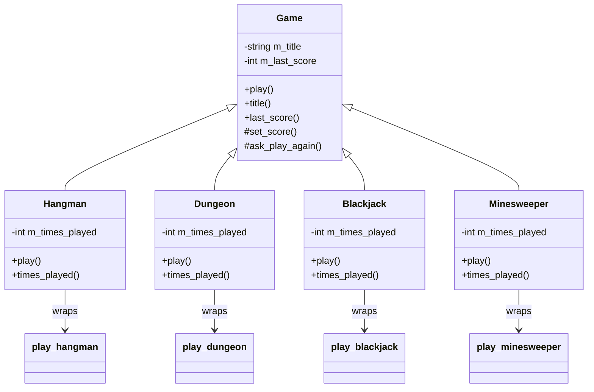

# Arcade class diagram

The upward arrows mean public inheritance (“is a”). The plain arrows show
which free-function implementation each wrapper uses.
There are no composition diamonds: the derived classes do not own a game
engine, deck, board, or player.
